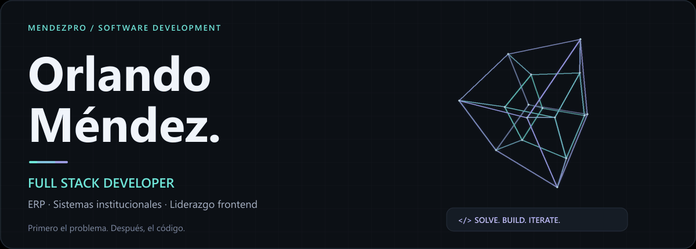
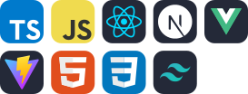
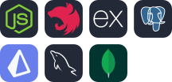

  

  
  
  

Desarrollo software para el sector público y privado. 
<b>Sistemas institucionales · Liderazgo de frontend y proyectos</b>

### Tecnologías con las que trabajo

<table align="center">
<tr>
<td width="50%" align="center" valign="top">
<h3>Frontend</h3>

TypeScript · JavaScript · React · Next.js · Vue Vite · HTML · CSS · Tailwind CSS

</td>
<td width="50%" align="center" valign="top">
<h3>Backend y datos</h3>

Node.js · NestJS · Express · PostgreSQL Prisma · MySQL · MongoDB

</td>
</tr>
<tr>
<td align="center" valign="top">
<h3>Herramientas</h3>

Git · GitHub · Docker · Figma · VS Code · Python

</td>
<td align="center" valign="top">
<h3>Multiplataforma</h3>

Flutter · Dart · Kotlin · Android Studio

</td>
</tr>
</table>

### Trofeos y actividad

  

Trofeos generados con GitHub Profile Trophy; son distintos de los Achievements oficiales. Las métricas públicas no representan todo mi trabajo en repositorios privados.

### Experiencia y proyectos

<table>
<tr>
<td width="50%" valign="top">

**Sistemas institucionales** · `Código privado`

Desarrollo de sistemas para el sector público y seguridad pública en Puebla.

</td>
<td width="50%" valign="top">

**NYCITO App** · `Sistema para cafetería`

Sistema integral para la operación y administración de una cafetería.

</td>
</tr>
</table>

Formación y forma de trabajo

TSU en Desarrollo de Software Multiplataforma. Ingeniería en Desarrollo y Gestión de Software, titulación en proceso.

Integro IA en mi flujo de desarrollo con criterio técnico y revisión del resultado.

<a href="mailto:soymendez56@gmail.com">soymendez56@gmail.com</a>

<!-- Original technology logos: tandpfun/skill-icons (MIT). Trophy cards: ryo-ma/github-profile-trophy (MIT), via a community endpoint listed by the upstream project. Assets cached in this repository; see licenses/ and PROFILE-DESIGN.md. -->
